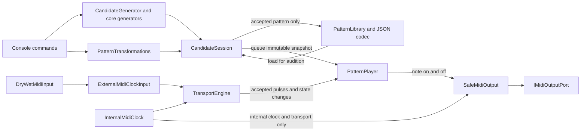

# Theory of operation

JamWeaver contributes one generated, MIDI-routed track to a live jam. Musical
content is prepared separately from playback: generators and transformations
create immutable patterns, the performer auditions a candidate, and MIDI Clock
advances the player through the selected pattern. The physical mixer controls
what the room hears; acceptance is an in-memory safe point, not an audio fade.

## Runtime composition and ownership

`JamWeaver.Console/Program.cs` is the composition root. It creates one
`SafeMidiOutput`, `TransportEngine`, `InternalMidiClock`,
`ExternalClockWatchdog`, `PatternPlayer`, `CandidateSession`,
`CandidateHistory`, and `PatternLibrary`, plus the generator implementations.
The same instances serve the whole interactive session.

`JamWeaverConsole.RunAsync` reads and dispatches commands. It owns the
replaceable `DryWetMidiInput` and subscribes the external-message bridge for the
duration of the loop. `GenerationControls` holds defaults for subsequent
generation; it does not edit the pattern already playing. `ConsoleDisplay`
writes presentation through a `TextWriter`; its device-listing methods also
enumerate native MIDI devices.

Core owns musical and timing behavior without terminal or DryWetMIDI types.
`IMidiOutputPort` is the hardware output boundary. The console adapter converts
user-facing channels 1-16 to DryWetMIDI's zero-based channels and constructs
library events. No device-specific patches or SysEx are part of this flow.

## Two paths meet at the player

Commands, generation, JSON work, and terminal output run outside pulse
processing. Player callbacks perform scheduling and synchronous MIDI sends.
External timing messages drive local transport and are never automatically
relayed to the output.

## From controls to musical material

`CandidateGenerator.Generate` combines the selected generator mode and controls
with a seed and the current candidate's tonal context and role. Without a
candidate, the console starts with A minor pentatonic in the bass role. An
explicit switch builds each generator's strongly typed settings; no runtime
plugin registry is required.

`IPatternGenerator<TSettings>.Generate` returns a `Pattern` containing ordered
steps and a recipe. A step contains simultaneous notes and one trigger
probability. Melodic pitches store scale degree, octave, and chromatic offset;
drum pitches store absolute MIDI note numbers. Patterns contain no output-port
or channel selection. Timing and step count are pattern data, although the
current phrase generators use sixteenth notes in 4/4.

Generation uses a seed-local Redzen random source. Determinism covers musical
material and recipe values; each generated snapshot still receives a new ID.
Fixed-seed tests protect versioned musical output. Playback reads materialized
steps and never reruns the generator.

`CandidateGenerator.Vary` resolves the parent recipe's original generator ID
and version through `IPatternGenerator.Lineage`, then calls that generator's
`Vary`. The generator selected for `new` does not affect this dispatch.
Mutation recipes identify the immediate operation and parent while retaining
original lineage for repeated variation. Turnaround Loop has family-specific
variation; the other current generators delegate to shared mutation algorithms.

Manual key, palette, role, or step transformations create a new snapshot and
clear the old recipe. Consequently a manually transformed candidate cannot use
`vary` through the current console lineage lookup. Renaming preserves identity
and recipe. See [pattern model](../sequencer/pattern-model.md) and
[pattern generation](../generation/pattern-generation.md).

## Candidate, accepted, current, and pending

These are separate roles, even when several refer to the same pattern:

| Role | Owner | Meaning |
| --- | --- | --- |
| Candidate | `CandidateSession` | Pattern selected for audition and editing |
| Accepted | `CandidateSession` | Single safe point eligible for saving |
| Current | `PatternPlayer` | Snapshot selected for pulse-driven playback |
| Pending | `PatternPlayer` | Latest replacement waiting for bar activation |
| Recent list | `CandidateHistory` | Eight candidates with a browsing cursor |

The first candidate also establishes Accepted. Later generation, variation,
loading, and manual transformations select candidates without replacing the
safe point. `keep` requires the candidate to be Current with no pending swap;
it does not require note output to be enabled or prove that audio was heard.
`revert` queues Accepted through the same audition path.

While stopped or clock-lost, a newly queued candidate immediately becomes
Current. While running, only the latest queued candidate is retained, with a
bar deadline based on the next pulse that has not been accepted. A four-bar
pattern joins the transport's absolute phrase phase;
activation at a bar boundary does not restart the pattern at its own first bar.
Stopping does not itself promote an existing Pending pattern.
MIDI Start resets position and plays a waiting candidate from its first step at
pulse zero. Continue preserves the pending deadline and existing phrase phase.
Neither operation changes Accepted, and muted output still permits activation.

Browsing changes the candidate through this same queue. Creating a new history
entry after moving backward discards the forward branch. Accepted is independent
of that bounded list. See [candidate workflow](../performance/candidate-workflow.md).

## Clock, position, and note scheduling

`TransportEngine` owns source, state, and pulse count. It defaults to external
clock and stopped state. Start resets position, Continue preserves it, and Stop
pauses it. Pulses from the wrong source or while not running are rejected.
Source selection stops transport and preserves position.

MIDI Clock is 24 pulses per quarter note: 96 pulses per 4/4 bar and six pulses
per sixteenth note. Each accepted clock publishes the pulse being processed,
then `Position` exposes the next pulse number. The first pulse after Start is
zero. `SequencerTimeline` is a separate boundary-calculation utility; the live
`PatternPlayer` calculates its own step indices and owns live pending swaps.
`TransportSnapshot` reads source, state, next pulse, and accepted Start count
together. Start increments the count; other transitions preserve it, allowing
pending swaps to distinguish a reset from a continuation.

For each pulse, the player:

1. Cleans up notes if pulse position moved backward or repeated.
2. Sends Note Off for expired gate deadlines.
3. Activates an eligible pending pattern at a bar boundary.
4. If output is enabled and this is a step boundary, selects the step from
   absolute pulse position modulo pattern length.
5. Makes a deterministic probability decision from musical content, loop
   number, and step index, then sends that step's notes.

Melodic pitches resolve through the selected tonal context and musical role at
playback. Gate duration is rounded up to whole clock pulses, with a minimum of
one and a maximum of one step. Expired notes are released before new notes at
the same pulse, allowing full-gate retriggering. Playback errors disable note
output and are retained in `PatternPlayer.Error` for `status`.

Internal clock uses `IClockPulseScheduler` with timed waits and a short spin.
It emits MIDI Start/Continue/Stop and Clock as well as driving local transport.
Its asynchronous lifecycle methods serialize commands and cancel/join the
previous run before replacement. A run's scheduler and pulse failures stop
local transport and remain in `InternalMidiClock.Error`; `status` reports them
as `ClockError` independently of player errors. Expected cancellation is quiet.
The console awaits clock commands; retrying Start or Continue clears the prior
error when the operation reaches the MIDI send stage.
The watchdog polls for external silence every 50 ms; its default timeout is
500 ms. Clock loss pauses transport, preserves position, and requires a new
Start or Continue. It never switches automatically to internal clock.

## Execution and shutdown limits

External messages are processed synchronously on the MIDI input callback;
internal pulses run on the scheduler's execution path; clock-loss detection
runs on the watchdog task. Console commands can run concurrently with them.
Transport serializes each mutation and its synchronous notifications through a
dispatch gate. Its separate state lock is released before callbacks, so state
queries remain available while delivery is in progress. Player and safe output
each lock their own state. An in-flight pulse finishes delivery before a
concurrent Stop changes state and releases notes. Subscribers may query
transport but must not initiate another mutation or wait for one; same-thread
reentrant mutations are rejected. Callback failures propagate while releasing
the gate. See the [notification contract](../midi/clock-transport.md#notification-ordering).

Queueing uses the first boundary whose pulse has not yet been accepted. Thus a
queue between pulses 95 and 96 activates at 96, while one after acceptance of
pulse 96 waits for 192 even if that callback is delayed. A newer Start count
allows pending material to activate on the restarted pulse zero.

Program disposes resources in reverse declaration order. Input closes when
the command loop exits. Internal clock disposal joins its scheduler, stops local
playback, and sends any Stop owed by its own successfully sent Start/Continue.
An unused clock sends no transport messages, and successful explicit Stop
prevents another during disposal. The watchdog and player are disposed next;
safe output performs final cleanup and disposes the port last. Shutdown Stop
errors retain output/operation context and propagate; nested resource scopes
still attempt later cleanup. Forced termination cannot guarantee this sequence.
Safe output attempts
tracked Note Off and CC 123 cleanup, but its cleanup loop exits on the first
send failure. See [clock and transport](../midi/clock-transport.md) and
[note lifecycle](../midi/note-lifecycle.md) before modifying these paths.

Desktop .NET is not hard real-time. Synchronous device calls, lock contention,
thread scheduling, and garbage collection can affect pulse delivery. Automated
tests and fake ports establish logic and expose failure cases; they do not
measure physical timing, audio quality, or device disconnect recovery.

## Persistence and extension boundaries

`save` serializes Accepted, optionally with a new name. `PatternLibrary` owns
file naming, same-process save serialization, temporary-file replacement,
listing, and duplicate-ID checks. `PatternJsonCodec` owns the versioned JSON
representation and reconstructs domain values on load. Format version 2 stores
materialized steps, tonal context, role, recipe, ancestry, and lineage.

Loading validates a file again and enters the result as Candidate. It leaves
routing and transport alone. Saved steps remain usable when a recipe cannot
be reconstructed or varied. See [pattern library](../persistence/pattern-library.md).

Keep musical rules in core generators or transformations, timing rules in
transport/player, and native event conversion in the console adapters. Add
boundaries where ownership or fake-driven tests need them. Follow
[adding a generator](../development/adding-a-generator.md) for generation work
and [project structure](project-structure.md) for the solution layout.
